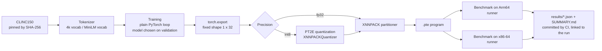

# edge-ml-on-arm

**Can a personal AI companion understand its user on the user's own Arm device, fast enough and accurately enough, without sending text to the cloud?**

This repository answers one concrete piece of that question with measurements: *intent understanding* (turning "remind me to call my mum at six" into the intent `reminder`) on Arm64 CPUs, using PyTorch for training and ExecuTorch + XNNPACK for deployment.

> **Status (20 Nov 2026):** pipeline, tests and CI are in place. The first full CI run (train → export → benchmark on Arm64 and x86-64) is pending. **No benchmark numbers are reported here until they come from that run**, linked to its log.

## Why this exists

I am building a privacy-first AI companion. One of its hard rules is that personal data and AI inference stay on the user's own devices. Almost every phone runs on an Arm CPU, so "can it run locally?" turns into a hardware-aware ML question: how big can the model be, how fast does it run, what does int8 quantization cost in accuracy, and where does the time actually go?

## The experiment

Two models, same code, same data, same input shape:

| | `tiny` | `minilm` |
|---|---|---|
| Architecture | 2-layer transformer encoder, 128 hidden, 4 heads | 6-layer transformer encoder (all-MiniLM-L6-v2), 384 hidden, 12 heads |
| Training | **trained from scratch** on CLINC150 | pretrained, **fine-tuned** on CLINC150 |
| Vocabulary | 4,096 WordPiece tokens learned from the training split | 30,522 WordPiece tokens (original) |
| Parameters | 944,919 (56% in embedding tables) | 22,439,191 (52% in embedding tables) |

Each is exported to ExecuTorch in **fp32** and **int8** (dynamic, per-channel int8 weights for every Linear layer) and measured on GitHub-hosted **Arm64** and **x86-64** runners:

- latency at batch size 1 (median, p90, p99) for 1, 2 and 4 threads
- accuracy *of the exported program itself* on the full test split
- file size and resident memory added when loaded

Dataset: **CLINC150** (150 everyday intents such as reminders, calendar, timers, to-do lists, plus an *out-of-scope* class). Out-of-scope matters for a companion: it must know when it does not understand. Metrics are the standard two: **in-scope accuracy** and **out-of-scope recall**.

## Pipeline



The *same* `.pte` files are benchmarked on both architectures.

## Engineering decisions

- **One encoder class for both models.** `src/edgeml/model.py` is written out layer by layer. MiniLM's pretrained weights are mapped into it, and a test checks it reproduces the reference Hugging Face BERT output (max difference about 2e-6). Differences between the two models come from size and training, not from different code.
- **Plain PyTorch training loop.** Forward, cross-entropy, backward, gradient clipping, AdamW, linear warm-up/decay, all visible in `src/edgeml/train.py`.
- **Validation for every choice, test once.** The checkpoint and the tiny model's hyper-parameters are chosen on the validation split. Sweeps never evaluate test (`scripts/sweep_tiny.py`).
- **Fixed 32-token input.** Covers 100% of MiniLM-tokenised test sentences (99.96% for the tiny vocabulary). Fixed shapes let ExecuTorch plan memory ahead of time, which is what an on-device runtime wants.
- **Measure the deployed artifact.** Accuracy is computed by running the `.pte` through the ExecuTorch runtime, not the PyTorch model, so a quantization or export problem cannot hide.
- **Pinned inputs.** Dataset, pretrained weights and tokenizer are pinned to exact versions and SHA-256 checksums.
- **Delegation report.** Each export records which operators XNNPACK took and which fell back to ExecuTorch's portable kernels (in ExecuTorch 1.6.0: embedding lookups and LayerNorm stay outside XNNPACK). Fallback ops are the first suspects when profiling.

## Reproduce

```bash
pip install --extra-index-url https://download.pytorch.org/whl/cpu -e ".[dev]"
pytest                                   # unit tests (some download data / weights)
edgeml train tiny && edgeml train minilm
edgeml export tiny && edgeml export minilm
edgeml benchmark                         # writes results/<machine>/benchmark.json
edgeml report                            # writes results/SUMMARY.md
```

Or run the **pipeline** workflow from the Actions tab: it does all of the above on an Arm64 runner and commits the results.

## Limitations

- GitHub's Arm64 runners are cloud server CPUs, not phones. They share the Arm instruction set and the same kind of int8/fp32 kernels, but phone cores have different clocks, caches and thermal limits. Treat absolute latencies as indicative; the *relative* comparisons are the point.
- Shared CI machines are noisy. Each configuration reports the full distribution (p90/p99, std), not only the median.
- Latency is measured from Python through the ExecuTorch bindings, which adds a small, constant per-call overhead.
- CLINC150 has only 100 out-of-scope training examples, so out-of-scope recall is expected to be the weak spot for both models.

## Roadmap

1. Per-layer profiling on Arm (where does the time go: attention, feed-forward, LayerNorm, embeddings?).
2. Per-layer quantization sensitivity, mixed precision, and a small tool that picks the best configuration for a given latency / size budget.
3. Wake-word detection: a tiny always-on audio model, the classic workload for small Arm cores and NPUs.
4. Small on-device LLM: tokens per second and memory for 4-bit vs 8-bit on Arm64.

## Credits

- CLINC150: Larson et al., *An Evaluation Dataset for Intent Classification and Out-of-Scope Prediction*, EMNLP 2019. CC BY 3.0.
- all-MiniLM-L6-v2: sentence-transformers, Apache-2.0.
- ExecuTorch, XNNPACK, PyTorch: their respective licenses.
